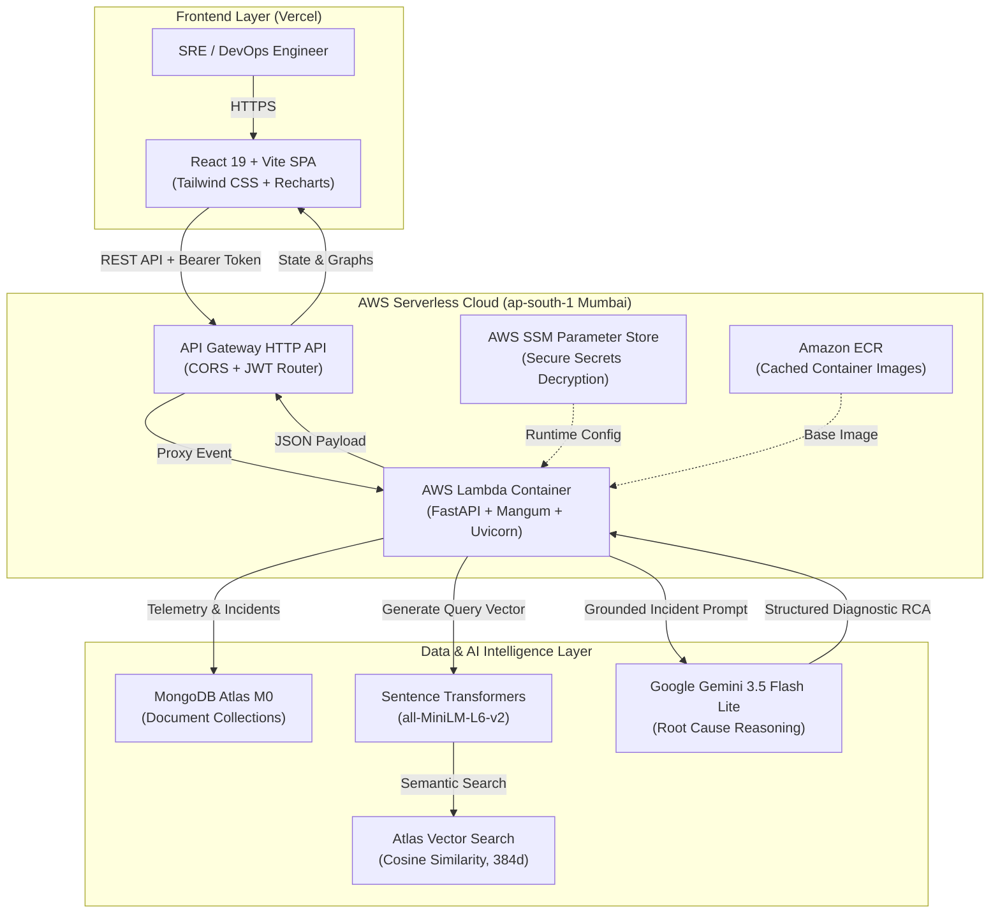
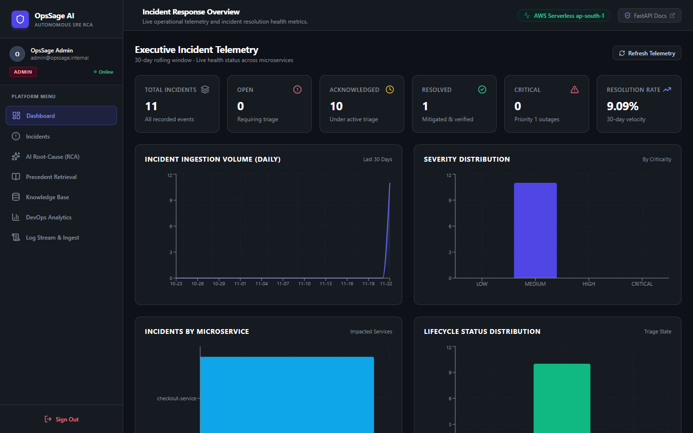
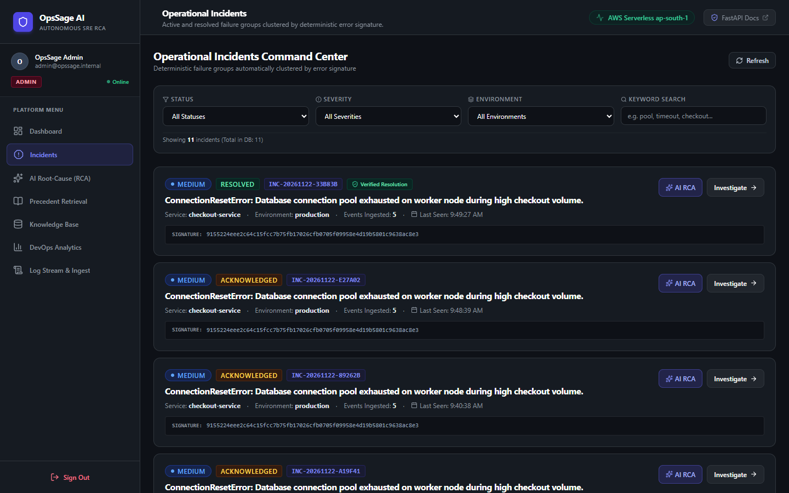
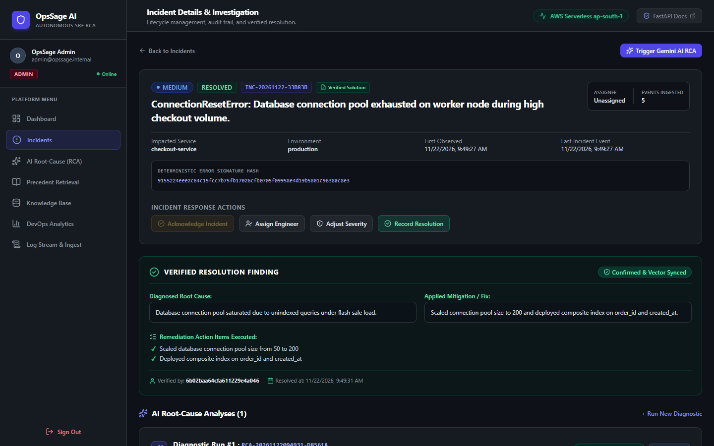
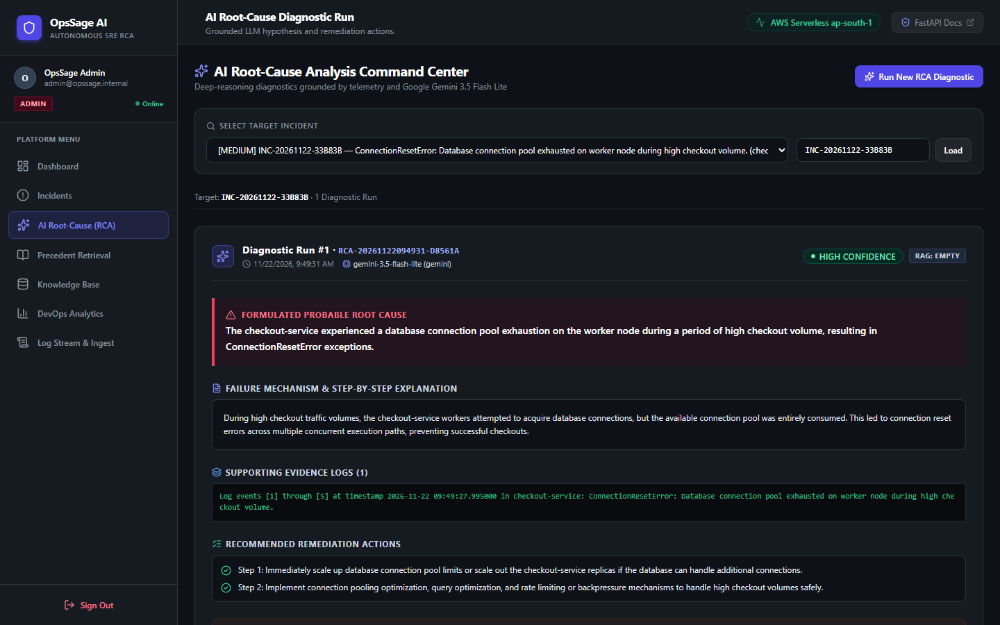
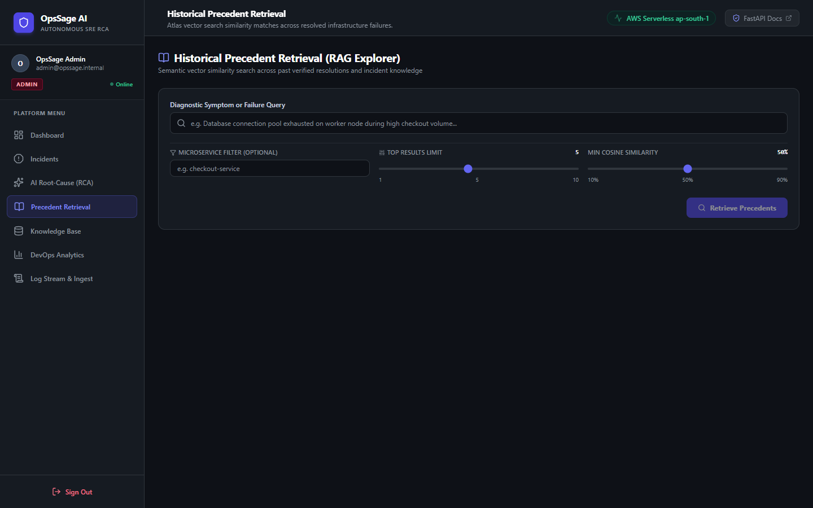
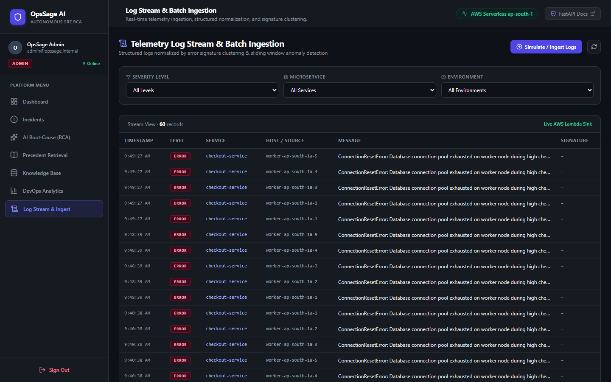
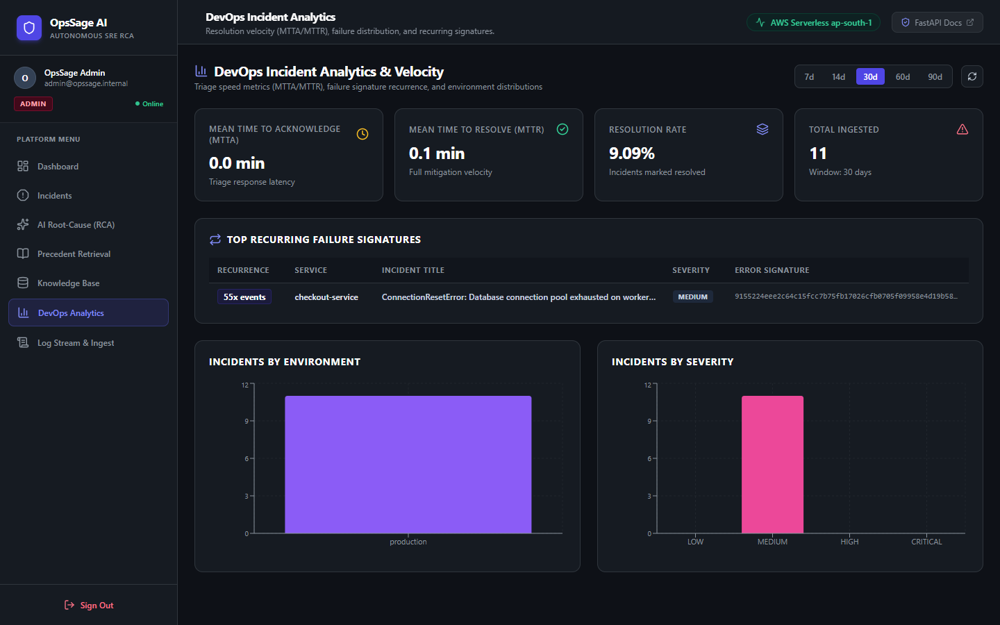
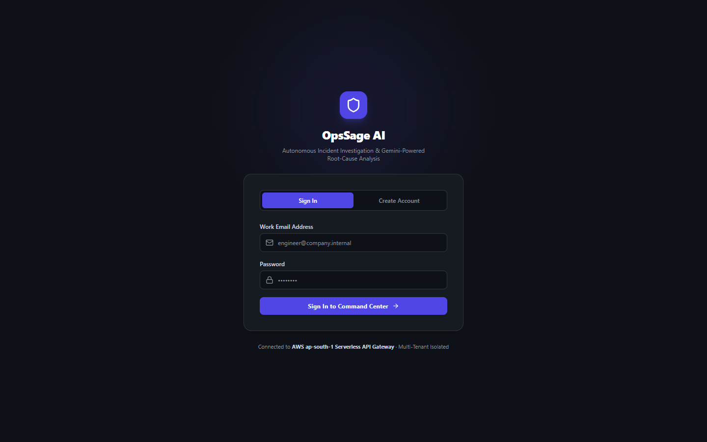

# OpsSage AI

> **Autonomous AI Site Reliability Engineer for Intelligent Incident Investigation & Root Cause Analysis.**

[](https://fastapi.tiangolo.com)
[](https://react.dev)
[](https://www.typescriptlang.org)
[](https://tailwindcss.com)
[](https://ai.google.dev)
[](https://www.mongodb.com/atlas)
[](https://aws.amazon.com)
[](https://ops-sage-ai.vercel.app)
[](#testing)

---

## 📌 Problem Statement

During high-severity cloud outages, on-call engineers are inundated with thousands of duplicate error logs, alert storms, and fractured context across disparate dashboards. Manually sifting through stack traces, correlating timestamps, and searching Slack or past post-mortems for proven fixes is slow, stressful, and drives up **Mean Time to Resolve (MTTR)**.

**OpsSage AI solves this.** It functions as an autonomous AI Site Reliability Engineer: ingesting chaotic log streams, deduplicating errors into distinct incident clusters, querying historical company fixes using vector search (RAG), and generating evidence-backed root cause analyses (RCA) with prioritized remediation checklists using **Google Gemini 3.5 Flash Lite**.

---

## 🏗️ System Architecture



---

## 🚀 Key Features

* **Log Ingestion & Parsing:** Normalizes structured JSON log streams, masks volatile variables (timestamps, IDs, memory offsets), and computes deterministic error signature hashes.
* **Deterministic Incident Clustering:** Groups repeat errors into deduplicated operational incidents using sliding time-window anomaly detection, preventing alert fatigue.
* **AI Root Cause Analysis:** Prompts **Google Gemini 3.5 Flash Lite** with grounded telemetry to output probable root causes, chronological failure mechanisms, and confidence ratings.
* **Evidence-Backed Recommendations:** Provides on-call engineers with prioritized, actionable remediation checklists tied directly to log evidence lines.
* **Historical Precedent Retrieval (RAG):** Performs 384-dimensional semantic similarity vector search across past verified resolutions using **Sentence Transformers** and **MongoDB Atlas Vector Search**.
* **Incident Lifecycle Management:** Supports end-to-end triage states (`OPEN`, `ACKNOWLEDGED`, `RESOLVED`), engineer assignment, severity adjustments, and verified resolution recording.
* **Immutable Audit Trail:** Append-only compliance log recording every state transition, timestamp, and actor email for thorough post-incident reviews.
* **Knowledge Base Synchronization:** Automatically embeds and indexes verified resolutions into the RAG vector index upon incident closure.
* **DevOps Reliability Analytics:** Visualizes Mean Time to Acknowledge (MTTA), Mean Time to Resolve (MTTR), 30-day velocity, and top recurring failure signatures with interactive Recharts.
* **Enterprise Security & RBAC:** Multi-tenant isolation enforced via JWT Bearer authentication and role-based access control (`admin`, `engineer`, `viewer`).

---

## 📸 Screenshots

| Executive Incident Telemetry (`/`) | Operational Incidents Command (`/incidents`) |
| :---: | :---: |
|  |  |

| Incident Lifecycle & Audit Trail (`/incidents/:id`) | AI Root Cause Analysis (`/analysis/:id`) |
| :---: | :---: |
|  |  |

| Historical Precedents / Vector RAG (`/precedents`) | Telemetry Log Stream & Ingestion (`/logs`) |
| :---: | :---: |
|  |  |

| SRE Incident Velocity & Analytics (`/analytics`) | Authentication Command Center (`/login`) |
| :---: | :---: |
|  |  |

---

## 🛠️ Technology Stack

| Domain | Technologies & Libraries |
| :--- | :--- |
| **Frontend** | React 19, TypeScript, Vite, Tailwind CSS, React Router v7, Recharts, Lucide Icons, Axios |
| **Backend** | FastAPI, Python 3.11, Mangum (ASGI Lambda Handler), Uvicorn, Pydantic v2 |
| **Database** | MongoDB Atlas (M0 Cluster), PyMongo (Native `AsyncMongoClient`), Motor |
| **AI & LLM** | Google Gemini 3.5 Flash Lite (`gemini-3.5-flash-lite`), Google GenAI REST API |
| **RAG & Vectors** | Sentence Transformers (`all-MiniLM-L6-v2`), Atlas Vector Search (Cosine Similarity, 384d) |
| **Cloud & Infra** | AWS Lambda (Container Image), AWS API Gateway (HTTP API in `ap-south-1`), Amazon ECR, AWS SSM Parameter Store, Vercel |
| **Testing & CI** | Pytest, Pytest-Asyncio (174 backend tests), Vitest (10 frontend tests), Puppeteer-Core, Docker |

---

## ⚡ How OpsSage AI Works

1. **Ingest & Hash:** Telemetry logs flow into `/api/v1/logs`. The engine normalizes error messages and computes a SHA-256 deterministic signature.
2. **Detect & Cluster:** Errors breaching the sliding window threshold trigger or append to an operational incident (`INC-YYYYMMDD-XXXXXX`).
3. **Retrieve Precedents:** The error signature and message are embedded into a 384-dimensional vector to query similar historical incident fixes.
4. **Diagnose with Gemini:** Gemini 3.5 Flash Lite receives log evidence + RAG precedent context to synthesize an objective root cause and step-by-step fix.
5. **Resolve & Index:** Once an engineer verifies the resolution, OpsSage updates the incident to `RESOLVED` and syncs the solution to the knowledge base vector store.

---

## 💻 Local Installation & Setup

### Prerequisites
* Python 3.10+
* Node.js 18+ & npm
* MongoDB Atlas cluster or local MongoDB instance
* Google Gemini API Key

### 1. Clone Repository
```bash
git clone https://github.com/Kavyansh180/OpsSage-AI.git
cd OpsSage-AI
```

### 2. Backend Setup
```bash
python -m venv .venv
# Windows: .venv\Scripts\activate | Unix: source .venv/bin/activate
pip install -r requirements.txt
cp .env.example .env
# Edit .env with your MONGODB_URI and GEMINI_API_KEY
uvicorn backend.app.main:app --reload --port 8000
```
Backend Swagger API documentation will be available at `http://localhost:8000/docs`.

### 3. Frontend Setup
```bash
cd frontend-react
npm install
npm run dev
```
Frontend development server will start at `http://localhost:5173`.

---

## 🧪 Testing

The platform maintains comprehensive test coverage across both unit and integration suites:

```bash
# Run backend test suite (174 passing: unit, integration, E2E)
pytest

# Run frontend test suite (10 passing: component, auth, badges, API)
cd frontend-react
npm test
```

---

## 🌐 Production Deployment

| Service | Hosting Provider | Endpoint / URL |
| :--- | :--- | :--- |
| **Frontend SPA** | Vercel | [https://ops-sage-ai.vercel.app](https://ops-sage-ai.vercel.app) |
| **API Backend** | AWS Lambda + API Gateway (`ap-south-1`) | [https://iulno515v4.execute-api.ap-south-1.amazonaws.com](https://iulno515v4.execute-api.ap-south-1.amazonaws.com) |
| **Interactive Docs** | AWS Serverless | [API Swagger Docs](https://iulno515v4.execute-api.ap-south-1.amazonaws.com/docs) |
| **Database** | MongoDB Atlas (AWS Mumbai) | Cloud Managed M0 |

---

## 🔒 Security Considerations

* **Zero Hardcoded Secrets:** Production AWS Lambda reads API keys, JWT secrets, and MongoDB URIs from AWS Systems Manager (SSM) Parameter Store with runtime KMS decryption.
* **Strict CORS Whitelisting:** Cross-Origin Resource Sharing is locked down to verified deployment domains (`ops-sage-ai.vercel.app` and local dev).
* **Multi-Tenant Isolation:** Database queries and incident mutations enforce tenant-isolated scopes derived strictly from signed JWT bearer tokens.
* **Immutable Compliance Trail:** State mutations cannot overwrite previous incident actions; all state modifications append to an audit collection.

---

## 🔮 Future Improvements

* **Alert Webhook Integrations:** Direct incident paging via Slack, PagerDuty, and Opsgenie webhooks.
* **OpenTelemetry Native Exporter:** Ingestion support for standard OTel collector protocol (gRPC / OTLP).
* **Automated Remediation Execution:** Opt-in automated rollback triggers via Kubernetes Operator upon high-confidence verified diagnoses.

---

## 👤 Author

**Kavyansh Singh**
* **GitHub:** [@Kavyansh180](https://github.com/Kavyansh180)
* **Project Repository:** [https://github.com/Kavyansh180/OpsSage-AI](https://github.com/Kavyansh180/OpsSage-AI)
